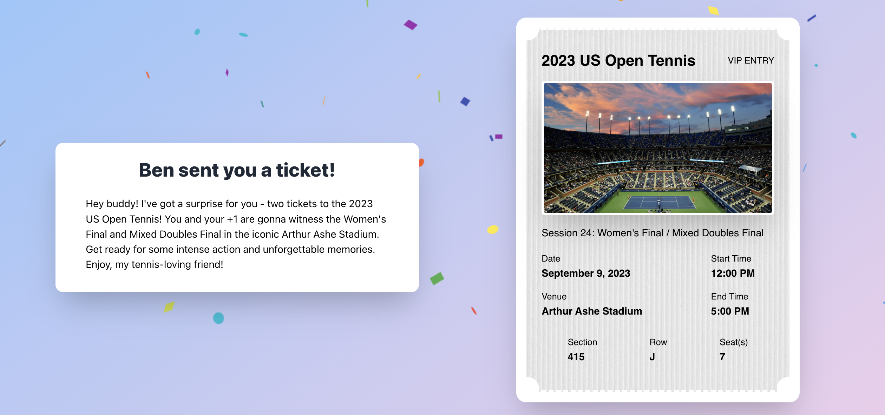

[](https://app.netlify.com/sites/prettytickets/deploys)

# Pretty Tickets™

## Transform purchases into beautiful commemorative tickets.



## Tools

1. [OpenAI](https://openai.com) Chat Completions API to generate gift message
2. [TinyURL](https://tinyurl.com) API to create short links to share
3. [Pixabay](https://pixabay.com/) API to pull image based on ticket context

## Architecture

- React create-react-app (using Typescript and Tailwind CSS)
- Netlify serverless backend (functions)
- Netlify hosting

## Getting Started

1. [Download Netlify CLI](https://docs.netlify.com/cli/get-started/)

2. Install Packages and Netlify CLI:

    ```bash
    npm i
    ```

    ```
    npm install netlify-cli -g
    ```

3. Run website and serverless backend locally (will be hosted on port 8888):

    ```bash
    netlify dev
    ```

### Environment variables

Set these in Netlify (Site configuration → Environment variables) or a local `.env` for `netlify dev`:

- `OPENAI_API_KEY` (required): used by the functions in `netlify/functions` via the OpenAI Responses API.
- `OPENAI_MODEL` (optional): overrides the default model (`gpt-6-luna`) without a code change.
